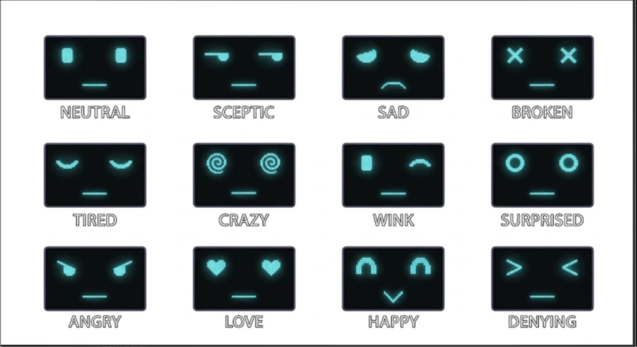

# Live Robot

A native Android app that turns a phone into a living robot face. One landscape, full-screen view shows two glowing cyan eyes and a mouth on near-black. The face blinks, drifts, changes mood, falls asleep at night, and reacts to touch and to the battery.



*Design sheet for the 12 base expressions. The app draws all of them as data, not as image assets.*

## Features

- **12 expressions plus extra states**: Neutral, Sceptic, Sad, Tired, Angry, Love, Happy, Surprised, Wink, Denying, and glitch states (Broken, Crazy), plus Waking, Sleeping, Charging and Low battery faces.
- **Idle life**: blinking, eye wander, breathing and drift, per-mood idle motion, and slow random mood changes.
- **Touch reactions**: tap, double tap, tap on an eye (wink), long press, petting with the eyes following the finger, swipes, and rapid taps that make it angry.
- **Time of day**: sleeps from 23:00 to 07:00 with an eye-droop entry and a slow wake-up, yawns in the evening, and dims the screen while asleep.
- **Battery awareness**: charging face with a lightning bolt, happy at 100%, and sad, tired and yawning reactions at 15% and 5%.
- **Hidden debug panel** (debug builds only): hold two fingers for 1 s to force any mood or gesture, fake the clock or battery, and browse galleries of every face.

## How it works

| Layer | What it does |
|---|---|
| `face/` | Face model (`FaceParams`), mood table (`Moods.kt`), easing, blink, drift, idle motion, gestures, and the Canvas renderer |
| `behavior/` | `BehaviorEngine`: base state (awake, sleeping, charging, low battery), reactions with priorities, mood drift, timers |
| `device/` | Battery monitor and clock source |
| `ui/` | Compose screen, touch input, debug panel |
| `Tuning.kt` | Every tunable number in one place |

Design choices worth a look:

- **Moods are data.** Each face is a row of numbers (eye shape, size, lid, mouth kind), and the animator eases between rows, so adding a mood means adding a row.
- **Pure-Kotlin logic.** The behavior engine, touch interpreter, animator, blinker and gestures have no Android dependencies. They are tested with fake clocks and injected `Random`.
- **60 fps with a glow.** The glow is drawn into a bitmap 6x smaller than the screen and stretched under the sharp face. Measured on a 2340x1080 phone: about 61 fps, under 1.1% janky frames, about 86 MB memory, no garbage collections in 60 s. Draw code allocates nothing per frame.
- **Dead ends are written down.** [DECISIONS.md](DECISIONS.md) records every design choice, including two glow approaches that were tried and dropped (a blur mask that used 700-900 MB of GPU memory, and a RenderEffect layer that never refreshed).

## Tech stack

Kotlin, Jetpack Compose, Android `Canvas` (no bitmaps, Lottie or game engine), JUnit for unit tests, Gradle with a version catalog. Min SDK 26.

## Build and run

Requires Android Studio and a device or emulator.

```bash
./gradlew assembleDebug        # build
./gradlew testDebugUnitTest    # run the unit tests
./gradlew installDebug         # install on a connected device
```

To open the debug panel at launch (debug builds only):

```bash
adb shell am start -n com.mylive.robot/.MainActivity --ez debug_panel true
```

To drive the battery reactions on a real phone:

```bash
adb shell dumpsys battery set level 15
adb shell dumpsys battery reset
```

## Project docs

The app was built from written specs, one small commit per task:

- [specs/02-android-setup.md](specs/02-android-setup.md) - setup and architecture
- [specs/03-face-model.md](specs/03-face-model.md) - face model and mood tables
- [specs/04-motion-rules.md](specs/04-motion-rules.md) - blink, drift, easing, gestures
- [specs/05-behavior-states.md](specs/05-behavior-states.md) - states, triggers, priorities
- [specs/06-task-list.md](specs/06-task-list.md) - ordered task list
- [DECISIONS.md](DECISIONS.md) - decision log

## Status

V1 is complete and signed off. Possible later work: motion-sensor reactions, haptics, sound and extra moods.

## License

MIT, see [LICENSE](LICENSE).
